# Oleksandr Andreiev

**Software Engineer & Product Developer | Ruby on Rails · Node.js · React | AI-assisted Development**

I'm a software engineer with **7+ years of commercial experience** building and maintaining production web applications. My main expertise is **Ruby on Rails**, and I also work with **Node.js (NestJS), React, and Vue.js** based on the needs of the product and the team's existing stack.

My work focuses on backend and full-stack engineering: developing APIs and integrations, implementing business logic, working with PostgreSQL, and improving established codebases. I value pragmatic solutions, maintainable code, and reliable delivery.

I approach development with a **product mindset**: understanding user and business needs, making practical technical trade-offs, and delivering useful features rather than focusing on a particular framework.

**AI coding agents are part of my daily workflow.** I use tools such as Claude Code and Codex to explore codebases, support implementation and refactoring, and move faster across different technologies. I still take responsibility for technical decisions, reviewing changes, and the final result.

I'm currently working with **Kodo Labs** and open to **part-time remote B2B collaborations (around 20 hours/week)**.

### Skills

  
  
  
  
  
  
    <a href="https://www.anthropic.com/claude-code" target="_blank" rel="noreferrer">
    <picture>
      <source media="(prefers-color-scheme: dark)" srcset="https://cdn.simpleicons.org/claudecode/ffffff" />
      <source media="(prefers-color-scheme: light)" srcset="https://cdn.simpleicons.org/claudecode/191919" />
      
    </picture>
  </a>
  
  
  
  
  
  

### Socials

  <a href="https://github.com/alex-andreiev" target="_blank" rel="noreferrer">
    <picture>
      <source media="(prefers-color-scheme: dark)" srcset="https://raw.githubusercontent.com/danielcranney/readme-generator/main/public/icons/socials/github-dark.svg" />
      <source media="(prefers-color-scheme: light)" srcset="https://raw.githubusercontent.com/danielcranney/readme-generator/main/public/icons/socials/github.svg" />
      
    </picture>
  </a>
  <a href="https://www.linkedin.com/in/alex-andreiev/" target="_blank" rel="noreferrer">
    <picture>
      <source media="(prefers-color-scheme: dark)" srcset="https://raw.githubusercontent.com/danielcranney/readme-generator/main/public/icons/socials/linkedin-dark.svg" />
      <source media="(prefers-color-scheme: light)" srcset="https://raw.githubusercontent.com/danielcranney/readme-generator/main/public/icons/socials/linkedin.svg" />
      
    </picture>
  </a>

### Badges

<b>My GitHub Stats</b>

<a href="https://github.com/alex-andreiev">
  <picture>
    <source media="(prefers-color-scheme: dark)" srcset="./profile/stats-dark.svg" />
    <source media="(prefers-color-scheme: light)" srcset="./profile/stats-light.svg" />
    
  </picture>
</a>

